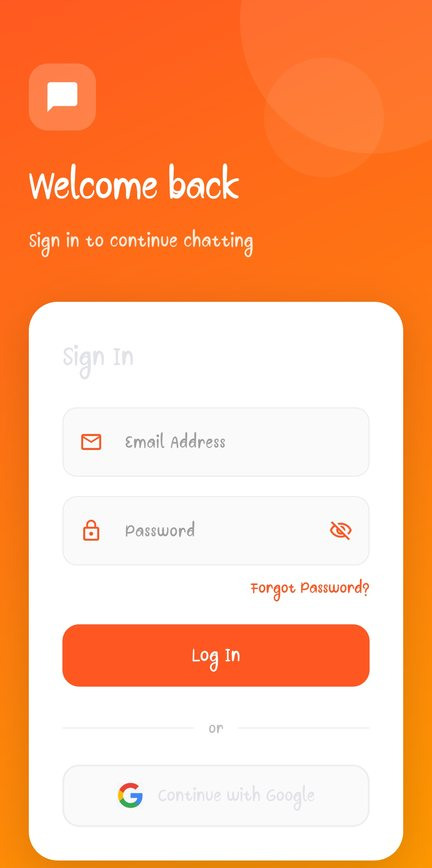
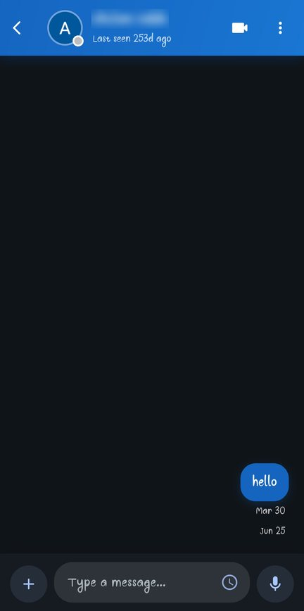
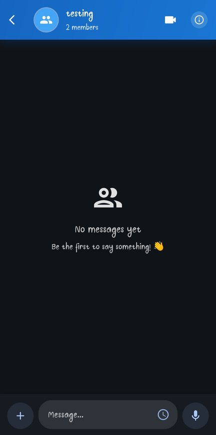
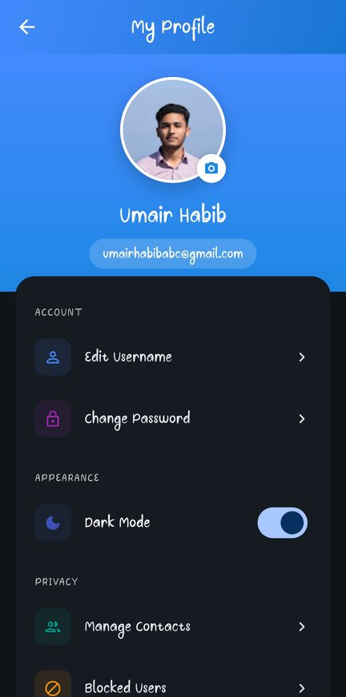

# 🔥 FireStream

**A real-time chat app for Android built with Flutter and Firebase: one-to-one and group chats with images, files and voice notes, admin-controlled groups, online status, and scheduled messages.**

[](https://github.com/Umair-Habibx123/firestream/actions/workflows/ci.yml)
[](https://github.com/Umair-Habibx123/firestream/releases/latest)
[](https://flutter.dev)
[](https://firebase.google.com)
[](LICENSE)

**[⬇️ Download the latest APK](https://github.com/Umair-Habibx123/firestream/releases/latest)** · Android 7.0+ · enable "Install unknown apps" for your browser or file manager first.

| Sign in | Chats | Chat | Group | Profile |
| :---: | :---: | :---: | :---: | :---: |
|  |  |  |  |  |

## Features

**Accounts**
- Sign in with email and password, or with Google
- Reset a forgotten password by email, and set or change your password
- Profile photo and details

**Chats**
- Real-time one-to-one and group messaging (Cloud Firestore)
- Send images, files and **voice notes**, with full-screen image preview
- Delete messages: your own, or any message if you're a group admin
- **Scheduled messages:** write now, deliver later
- **Online status and last seen**

**Contacts**
- Add contacts by their account email
- Block contacts you don't want to hear from

**Groups**
- Create groups, add members one by one or from your contacts, and remove them
- Admins: promote or demote admins, rename the group, change its photo, or delete it
- **Admin-only messaging:** restrict who can send messages

**Also:** light and dark themes, and a no-internet notice.

## Install

1. Open the **[latest release](https://github.com/Umair-Habibx123/firestream/releases/latest)** and download `FireStream-vX.Y.Z.apk`.
2. Optionally check it against the `.sha256` file next to it.
3. Open the APK on your phone and allow installing from that app if Android asks.

v1.2.0 uses a new app ID (`com.umairhabib.firestream`), so uninstall v1.0 or v1.1 first.

## Build it yourself

You need **Flutter 3.47+**, the Android SDK and your own Firebase project.

1. **Create a Firebase project** at [console.firebase.google.com](https://console.firebase.google.com/) and enable:
   - **Authentication** with the Email/Password and Google providers
   - **Cloud Firestore** and **Storage**
2. **Add an Android app** with package name `com.umairhabib.firestream`, and add your signing key's **SHA-1** and **SHA-256** fingerprints. Google Sign-In needs them; get yours with `cd android && ./gradlew signingReport`. Download `google-services.json` into `android/app/`.
3. **Create `.env`** in the project root with your Firebase web, Android, iOS and Windows app values, which `lib/firebase_options.dart` reads. The variable names are the `FIREBASE_*` keys used in that file, for example:
   ```env
   FIREBASE_ANDROID_API_KEY=...
   FIREBASE_ANDROID_APP_ID=...
   FIREBASE_ANDROID_MESSAGING_SENDER_ID=...
   FIREBASE_ANDROID_PROJECT_ID=...
   FIREBASE_ANDROID_STORAGE_BUCKET=...
   ```
4. Run it:
   ```bash
   flutter pub get
   flutter run                     # on a connected phone or emulator
   flutter build apk --release     # APK in build/app/outputs/flutter-apk/
   ```

| Command | What it does |
|---|---|
| `flutter test` | Runs the tests (chat-list time labels) |
| `flutter analyze` | Static analysis |

> **About security:** Firebase config values (API key, app ID, project ID) are public identifiers that ship in every app, so they aren't secrets. What protects the data is your **Firestore and Storage security rules**; set them so users can only read and write their own chats and the groups they belong to.

## How it's built

| Part | What it uses |
|---|---|
| Backend | Firebase Authentication, Cloud Firestore, Firebase Storage |
| Sign-in | `firebase_auth`, `google_sign_in` |
| State | `provider` |
| Media | `image_picker`, `file_picker`, `record`, `audioplayers`, `photo_view`, `dio` for downloads |
| Device | `connectivity_plus`, `permission_handler`, `shared_preferences` |

```
lib/
├── main.dart                 app setup and Firebase init
├── firebase_options.dart     reads the Firebase config from .env
└── features/
    ├── authentication/       sign-in, password reset, profile, contacts and blocklist
    ├── chat/screens/         chat list, one-to-one chat, group chat, group details and settings
    ├── services/             presence, scheduled messages, voice recording, theme, connectivity
    └── utils/                shared helpers (chat-list time labels)
```

Scheduled messages are delivered by the app itself, so the project stays on Firebase's free Spark plan, which doesn't include Cloud Functions. See `lib/features/services/scheduled_message_service.dart`.

## Releasing (for maintainers)

Pushing a version tag builds a signed APK in GitHub Actions and publishes it as a release:

```bash
git tag v1.2.0
git push origin v1.2.0
```

The workflow needs these repository secrets: `GOOGLE_SERVICES_JSON_BASE64`, `DOTENV_BASE64`, `ANDROID_KEYSTORE_BASE64`, `ANDROID_KEYSTORE_PASSWORD`, `ANDROID_KEY_ALIAS` and `ANDROID_KEY_PASSWORD`. See [`.github/workflows/release.yml`](.github/workflows/release.yml).

## License

[MIT](LICENSE) © 2025 [Umair Habib](https://github.com/Umair-Habibx123)
